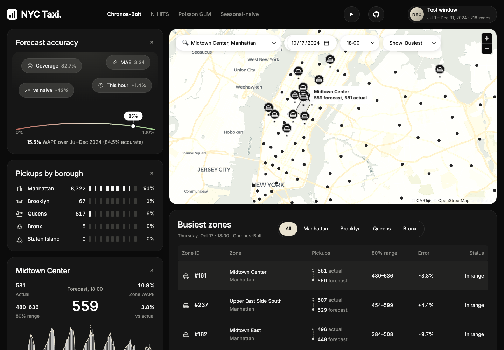
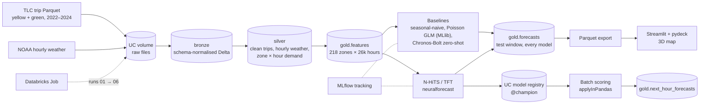
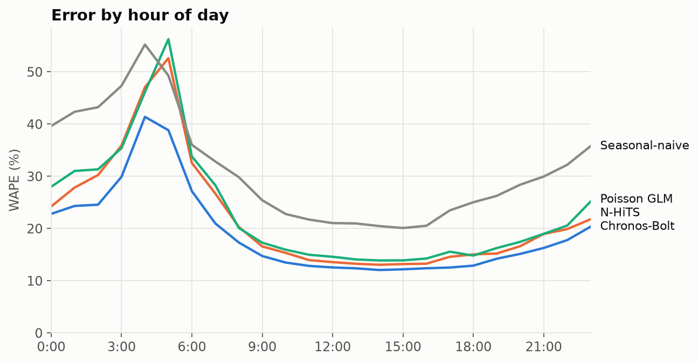
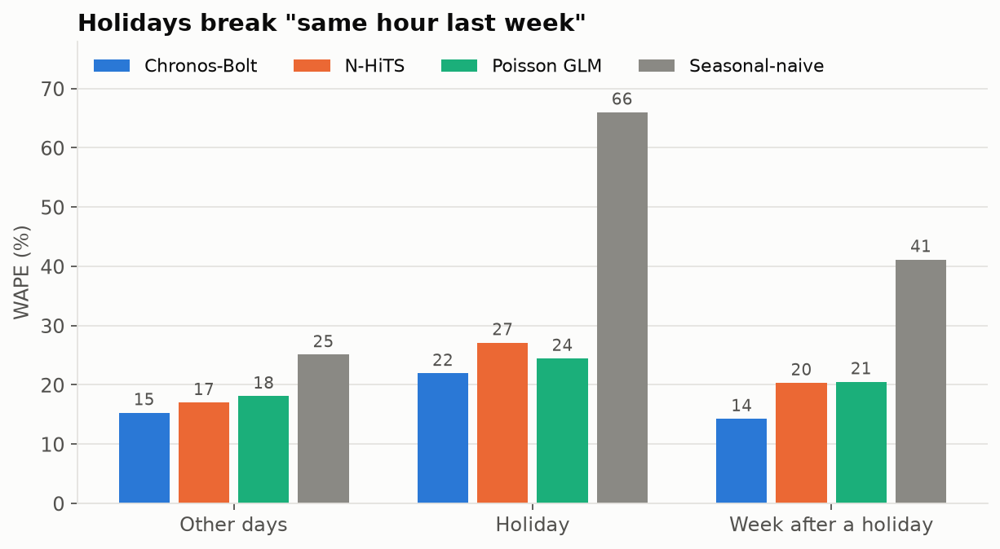
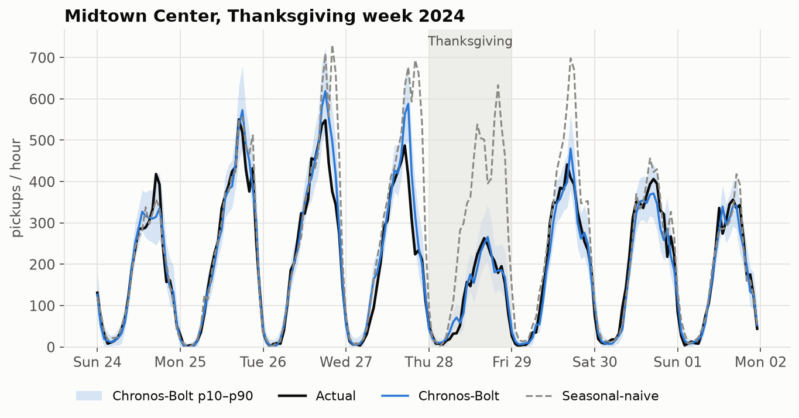

# NYC Taxi Demand Forecasting: hourly forecasts for every taxi zone in NYC


[](https://nyc-taxi-forecasting.streamlit.app/)

**Forecasts next-hour taxi pickups for 218 NYC taxi zones.** It covers every yellow and green taxi trip from 2022–2024, plus hourly NOAA weather, in a medallion pipeline on Databricks. Over a six-month out-of-time test (962,688 zone-hours per model), a zero-shot **Chronos-Bolt** foundation model scores **15.5% WAPE**, which is **42% lower error than a seasonal-naive baseline**. It beats N-HiTS and a Spark MLlib Poisson GLM trained on two years of this data. Its forecasts come with calibrated 80% prediction intervals. The whole pipeline runs as one Databricks Job, and the forecasts can be explored on an interactive 3D map.

**[▶ Live demo](https://nyc-taxi-forecasting.streamlit.app/)**: scrub through any hour of July–December 2024, switch models, and click a zone to see its forecast against what actually happened.



---

## Contents

1. [Project overview](#project-overview)
2. [Architecture](#architecture)
3. [Key findings](#key-findings)
4. [Results](#results)
5. [Quickstart](#quickstart)
6. [Interactive map](#interactive-map)

---

## Project overview

**The problem.** Dispatchers and fleet operators need to know where demand will be in the next hour, so they can send cars there before the riders are waiting. A useful forecast also needs a range ("between 180 and 260 pickups"), not just one number, because the cost of being short differs from the cost of being over.

**The data.**
- **Trips:** [NYC TLC trip records](https://www.nyc.gov/site/tlc/about/tlc-trip-record-data.page), yellow and green taxis, January 2022 – December 2024: 144 monthly Parquet files, aggregated to pickups per zone per hour.
- **Weather:** NOAA hourly weather for Central Park.
- **Holidays:** US federal and New York State holidays.

**What this project does**, from raw files to a deployed map:

| Stage | What happens | Tools |
|---|---|---|
| Ingest | Each monthly file is read separately and mapped onto one schema, because TLC column types and names change between months. Weather is downloaded one month at a time and checked to be complete. | PySpark, Delta Lake, Unity Catalog volumes |
| Clean | 5 rules: bad distance, bad fare, impossible duration, unknown zone, pickup outside the file's month. Each dropped trip is tagged with the first rule it fails (January 2024: 3.9% dropped). | PySpark |
| Aggregate | Pickups per zone per hour on a gap-free grid, with weather moved onto NYC wall-clock time across daylight-saving changes | PySpark |
| Features | Lags (1, 2, 24, 168 h), rolling means, calendar, holidays and weather, all computed from hours before the forecast hour | PySpark window functions |
| Model | Seasonal-naive, Poisson GLM, zero-shot Chronos-Bolt, N-HiTS and a Temporal Fusion Transformer, all scored on the same test rows | Spark MLlib, Chronos, neuralforecast |
| Track and register | Every model is an MLflow run. The best trained model is registered in Unity Catalog as `@champion`. | MLflow, Unity Catalog |
| Score | `@champion` forecasts the next hour for every zone, one zone per Spark task. The run fails if the registered model doesn't reproduce its own backtest. | `applyInPandas` |
| Orchestrate | One Databricks Job runs notebooks 01 → 06 from this repo on serverless compute | Databricks Jobs |
| Visualize | 3D map of forecasts vs actuals, with a zone drill-down | Streamlit, pydeck, Altair |

**Roles this project demonstrates:**
- data science: time-series evaluation, baselines, foundation-model benchmarking, prediction intervals, error analysis;
- ML engineering: MLflow, the model registry, batch inference, memory profiling;
- data engineering: medallion architecture, schema drift, Spark, orchestration.

---

## Architecture



All the logic lives in `src/taxi/` as plain Python modules. The notebooks are thin wrappers, so the cleaning rules, features, metrics, models and scoring are unit-tested locally on a Spark session. Notebooks reach Databricks through a Git folder, and the Job runs them straight from GitHub `main`. Everything runs on Databricks Free Edition serverless compute.

---

## Key findings

- **A pretrained model beat every model trained on this data.** Chronos-Bolt has never seen NYC taxi data. Given only each zone's last 512 hours, it scores 15.5% WAPE, against 17.4% for N-HiTS trained on two years of these zones. For one-hour-ahead forecasts, recent history carries most of the signal, and a model pretrained on many time series uses it well.
- **Holidays break "same hour last week".** Seasonal-naive's error jumps from **25% to 66%** on holidays, and is still **41%** the week after, when "last week" was the holiday. Chronos handles it best: **22%** on holidays and **14%** the week after.
- **Extra inputs made the neural models worse.** On a 7-week development slice, adding calendar and weather inputs took N-HiTS from 16.8% to 19.0% and then 22.4% WAPE, and the TFT (23.0%) lost to history-only N-HiTS (16.7%). Two causes:
  - neuralforecast's per-window scaling turned rare flags like `is_holiday` into values around 10⁶ whenever they fired. That is fixed with train-split scaling saved with the model.
  - Weather, which is identical across zones, let the models memorise dates.
- **Training ran out of memory at full scale, and the fix didn't need a bigger machine.** neuralforecast copies every training window of a batch at once. With 64 zones, two years of hours and 14 input columns, that is about 10 GB, and the Free Edition kernel has 15.6 GB. Passing each model only the columns it uses (14 → 2 for N-HiTS) and 16 zones per step made it fit.
- **The neural models slightly under-forecast total demand** (Chronos −2.4%, N-HiTS −3.6%). That fits forecasting the median of right-skewed counts. The Poisson GLM, which models the mean, is within 0.2%.

---

## Results

Test window: July 1 – December 31, 2024, which no model saw during training or early stopping. That's 4,416 hours × 218 zones = **962,688 forecasts per model, on identical rows**. Each hour is forecast one step ahead from the hours before it. The trained models learn from 2022–2023 and early-stop on 2024 H1.

| Model | Inputs | WAPE | MAE | RMSE | p10–p90 coverage | vs naive |
|---|---|---:|---:|---:|---:|---:|
| **Chronos-Bolt** (zero-shot) | pickup history | **15.5%** | **3.24** | **9.45** | 82.7% | **−42%** |
| N-HiTS (`@champion`) | pickup history | 17.4% | 3.65 | 10.80 | 79.7% | −35% |
| Poisson GLM (Spark MLlib) | zone × hour-of-week, weather, holidays, lags | 18.4% | 3.85 | 11.27 | — | −31% |
| Seasonal-naive (same hour last week) | — | 26.8% | 5.62 | 18.84 | — | — |

The metric is WAPE (total absolute error ÷ total pickups) rather than MAPE, because many zone-hours have zero pickups, where MAPE is undefined. N-HiTS's nominal 80% interval covers 79.7% of actual values. `@champion` is chosen among the trained, registered models; Chronos is evaluated as a baseline. The TFT runs on the development slice only (23.0% WAPE), because at full scale it would take many hours on CPU.

### Where the models are accurate, and where they aren't

| Zones, by average demand | Share of pickups | Chronos-Bolt | N-HiTS | Poisson GLM | Seasonal-naive |
|---|---:|---:|---:|---:|---:|
| Busiest 20 | 62% | 12.3% | 14.2% | 14.8% | 22.7% |
| Next 40 | 35% | 16.1% | 18.0% | 18.5% | 27.6% |
| Next 60 | 3% | 55.7% | 59.6% | 63.3% | 79.8% |
| Quietest 98 | 0.7% | 95.9% | 97.9% | 135.6% | 133.9% |

Error is low where it matters most: the 60 busiest zones carry 96% of all pickups. In quiet zones, a few pickups an hour are close to random. There the Poisson GLM does worse than naive, because its log link amplifies the lag features of near-empty zones.

| Error by hour of day | Holidays |
|---|---|
|  |  |
| Afternoons are easiest (~12%). The 4–5 a.m. lull is hardest, because tiny counts make relative error large. | Every model has more error on holidays, but naive breaks down twice: on the day and again a week later. |



*Midtown Center over Thanksgiving week. Seasonal-naive repeats the previous Thursday's rush hour. Chronos-Bolt picks up the quiet holiday from the hours just before it.*

---

## Quickstart

**On Databricks** (the [Free Edition](https://www.databricks.com/learn/free-edition) is enough):

1. Go to **Workspace → Create → Git folder** and paste this repo's URL.
2. Run `notebooks/00_setup` once. It creates the `nyc_taxi` catalog, the bronze/silver/gold/ml schemas, the volume and the MLflow experiment.
3. Create a Job from [`jobs/pipeline.yml`](jobs/pipeline.yml) (**Jobs & Pipelines → Create → Job → Edit as YAML**) and run it. It runs ingest → clean → features → baselines → neural models → scoring, which takes about 3 hours on serverless compute.

`config.DEV_MODE = True` in `src/taxi/config.py` limits everything to January–March 2024, for quick iterations.

**Locally** (needs Java 17 for Spark):

```bash
uv venv --python 3.11 .venv && uv pip install --python .venv/bin/python -r requirements-dev.txt
.venv/bin/python -m pytest                   # 24 tests on a local Spark session
.venv/bin/python scripts/local_smoke.py      # the data pipeline on one real month, without Databricks
```

The tests cover:
- each cleaning rule, schema drift, and DST handling in the weather join;
- the gap-free demand grid, and lags that never look ahead;
- metrics, and train-only scaling;
- neural backtests, including save → load → predict giving the same forecasts;
- Spark batch scoring with a saved MLflow model reproducing its backtest.

---

## Interactive map

**Live:** https://nyc-taxi-forecasting.streamlit.app/

| Control | What it does |
|---|---|
| Model | Chronos-Bolt, N-HiTS, Poisson GLM or seasonal-naive. The headline numbers update to that model's test WAPE and coverage. |
| Day and hour | Any hour of the test window. **Play this day** steps through all 24 hours. |
| Colour by | Demand, or forecast error (blue = under-forecast, red = over-forecast) |
| Click a zone | A week of actual vs forecast pickups for that zone with the p10–p90 band, and each model's WAPE there |

Column height is the forecast for the selected hour. Columns sit on zone centres rather than extruding whole zones, so a large zone like JFK doesn't look busy just because it's large.

The app reads a Parquet export of `gold.forecasts`: 3.85M rows, 11 MB. Notebook [`07_export_app_data`](notebooks/07_export_app_data.py) writes it. The zone shapes come from the TLC shapefile via [`scripts/build_zone_geojson.py`](scripts/build_zone_geojson.py).

```bash
streamlit run app/app.py
```
